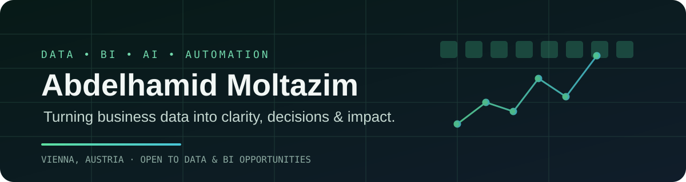

---

## About

Data Analyst with a **Master’s in Computing Science**, focused on Business Intelligence, AI-assisted workflows and automation. I transform messy operational data into trusted datasets, meaningful KPIs, clear reporting, and smarter processes.

- **25+ clients** supported through data and analytics projects since 2023
- Core toolkit: **SQL · Python · Power BI · Excel**
- Focus areas: **BI & analytics · AI applications · process/workflow automation · data quality**

---

## Tech stack

---

## AI & Automation

Exploring how AI and automation can reduce repetitive work and make analytics workflows more useful.

- **AI-assisted analysis** — use AI to support exploration, interpretation, and insight communication
- **Workflow automation** — streamline repeatable data preparation, reporting, and business tasks
- **Python automation** — build scripts for practical data-processing and productivity workflows
- **Human-in-the-loop** — keep outputs reviewable, grounded, and quality-checked

---

## Selected work

<table>
<tr>
<td width="50%" valign="top">

### 🛒 E-commerce Analytics
**BigQuery · SQL · Power BI**

Warehouse workflow, SQL transformations, and analytics-ready marts.

[Repository ↗](https://github.com/Moltazim-Data/ecommerce-analytics-bigquery-powerbi)

</td>
<td width="50%" valign="top">

### 🎯 Customer RFM Segmentation
**Python · Analytics**

Customer value segments, repeat behavior, and cohort exploration.

[Repository ↗](https://github.com/Moltazim-Data/Ecommerce-RFM-Analytics)

</td>
</tr>
<tr>
<td width="50%" valign="top">

### 🧪 ETL & Data Quality
**Python · Validation · ETL**

Reusable pipeline structure, quality checks, and reporting.

[Repository ↗](https://github.com/Moltazim-Data/ETL-Data-Quality-Framework)

</td>
<td width="50%" valign="top">

### 📈 Revenue Operations Analytics
**Sales funnel · Pipeline KPIs**

Conversion, pipeline tracking, and sales-cycle analysis.

[Repository ↗](https://github.com/Moltazim-Data/Revenue-Operations-Sales-Pipeline-Analytics)

</td>
</tr>
<tr>
<td width="50%" valign="top">

### 🎧 Customer Support Analytics
**Service KPIs · SLA**

Backlog, service levels, workload, and satisfaction metrics.

[Repository ↗](https://github.com/Moltazim-Data/Customer-Support-Service-Analytics)

</td>
<td width="50%" valign="top">

### 🔍 AuditScopeData
**Python · Streamlit**

Data profiling and exploratory group comparisons.

[Repository ↗](https://github.com/Moltazim-Data/AuditScopeData)

</td>
</tr>
<tr>
<td width="50%" valign="top">

### 🏭 Procurement Cost Analysis
**Supplier scorecards**

Supplier comparisons across cost, lead time, and quality indicators.

[Repository ↗](https://github.com/Moltazim-Data/Procurement-Cost-Optimization)

</td>
<td width="50%" valign="top">

### 📊 SharePoint Sales Reporting
**Power BI · SharePoint**

KPI measures and connected workbook reporting workflow.

[Repository ↗](https://github.com/Moltazim-Data/PowerBI-SharePoint-Sales-Analytics)

</td>
</tr>
</table>

---

## GitHub metrics

 

### Contribution activity

---

## Background

- **Master’s in Computing Science**
- Applied mathematics & computer science
- Google Data Analytics Certificate
- Software-development training at **42 Vienna**
- Languages: **German (B2) · English · French · Arabic**

## Let's connect

Interested in **Data Analyst · BI Analyst · Analytics & Automation** roles in Vienna or remote/hybrid.

<a href="https://moltazimdata.com">Portfolio</a> · <a href="https://www.linkedin.com/in/abdelhamid-moltazim">LinkedIn</a> · <a href="mailto:moltazim10@gmail.com">Email</a>

